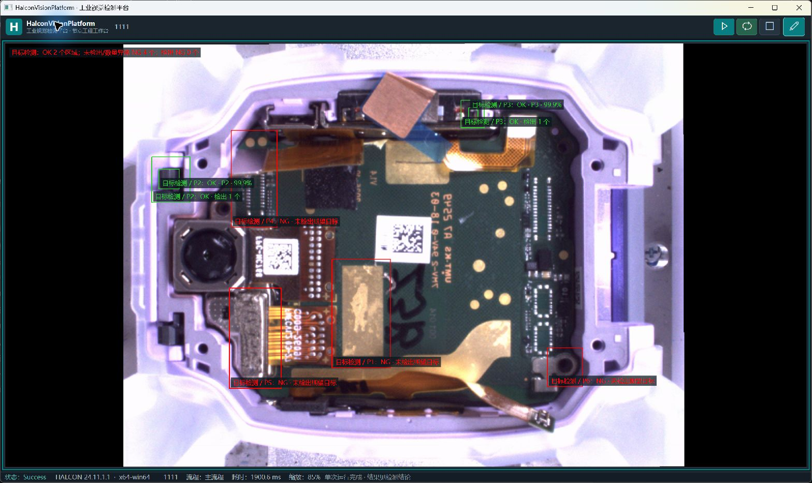

# 1111定位与目标检测链路验证 · 2026-10-21

## 本轮范围

继续上轮位置矫正工作，在1111的独立副本中接通四节点。使用已检查发布目录的冻结副本 `artifacts/aligned-detection-20261021/App`，没有覆盖桌面原方案、原图、模板或模型，也没有合入工作区中另一批检测任务编辑改动。应用业务源码本轮未修改，桌面启动路径不变。

输入目录为 `C:\Users\feng\Desktop\原图\1`。沿用1111已保存模板与2592×1944位置基准；连接原图到匹配及矫正、匹配poses到矫正、矫正image到检测。六个ROI来自既有P1～P6方案，检测模式以矫正图为底图。

模型来自相邻训练平台 `models/detection/结果/run_20261020_182230_e5db1fd3`，HALCON rectangle1，输入256×256，类别ID5～10对应P1～P6。置信度0.5，逐ROI按同名类别筛选、期望数量1。模型状态仍为 `bootstrap_unvalidated`，本轮没有重新训练或执行独立精度评估。

## 自动检查

| 检查 | 实际范围 | 结果 |
| --- | --- | --- |
| 完整1111四节点 | 排序前三张真实原图；空图失败；恢复第一张；取消、坐标、释放、缓存、保存恢复及哈希 | 36项通过 |
| 位置链原有回归及实际DL | 包含受控平移12行/10列、旋转3°后的实际检测 | 542项通过 |
| 原图直接检测 | 12张抽样原图、72个ROI；此项**没有位置矫正** | 无运行错误；68个区域接受目标、4个未检出 |

四节点真实前三张分别为 `OR_1_N05A00522B_18_37_41.jpg`、`...18_37_50.jpg`、`...18_37_59.jpg`。每张以及失败后的恢复帧均为P2/P3检出，P1/P4/P5/P6未检出；这是同一编号附近帧，不是跨批次独立样本。不能把另外12张原图直接检测的结果当作这条完整矫正链的结果。

空图测试实际执行匹配，随后位置矫正明确 `POSE_NOT_FOUND`，目标检测 `Skipped` 且运行输出字典不含检测节点；下一张正常图恢复。逐帧输出释放后原生对象均未初始化，两个缓存结束时为0。输入检查方案及模型三个文件前后哈希一致。

完整四节点CLI首次含加载约63.8秒，随后两帧约2.34秒，恢复帧约2.32秒。原图直接检测排除首张后的平均约1.94秒。不同进程初始化成本不同，数据不作为节拍保证或P95性能结论。

命令与本机原始结果：

```powershell
dotnet artifacts/aligned-detection-20261021/HalconDetectionTrial/HalconDetectionTrial.dll artifacts/detection-p1-p6-accepted/原图六位置目标检测.hvproj D:/AiProjects/HalconTrainingPlatform/models/detection/结果/run_20261020_182230_e5db1fd3 artifacts/aligned-detection-20261021/latest-model-detection --limit=12 --confidence=0.5 --pattern=OR_*.jpg

dotnet artifacts/aligned-detection-20261021/HalconPositionCorrectionTrial/HalconPositionCorrectionTrial.dll artifacts/quick-match-drawing-release-20261020 artifacts/aligned-detection-20261021/position-detection-regression artifacts/aligned-detection-20261021/latest-model-detection/原图六位置目标检测.hvproj

dotnet run --project tools/HalconAlignedDetectionTrial/HalconAlignedDetectionTrial.csproj -c Release -p:NuGetAudit=false -p:ValidatedRuntimeDir=D:/AiProjects/HalconVisionPlatform/artifacts/aligned-detection-20261021/App -- artifacts/aligned-detection-20261021/1111_定位检测验证.hvproj artifacts/aligned-detection-20261021/full-pipeline-check
```

输出目录必须全新；复跑请更换目录名。随仓库保存[36项汇总](aligned-detection-20261021/full-pipeline-summary.json)、[空图失败明细](aligned-detection-20261021/missing-pose.json)、[12张原图汇总](aligned-detection-20261021/raw-detection-summary.json)、[542项汇总](aligned-detection-20261021/position-regression-summary.json)和[模型哈希](aligned-detection-20261021/model-hashes.json)。大模型、原图和发布二进制不提交。

## 真实WPF检查

独立检查进程加载 `1111_定位检测验证.hvproj`，连续点击两次单次运行，四节点均完成。第二张位置偏移约行−0.22、列21.31、角度−0.13°，总耗时约1900.6ms。切到检测模式，实际显示P2/P3绿色检测框及其他四个区域红色未检出。Ctrl+S显示“项目已保存”，随后正常关闭本轮检查窗口，检查进程已退出。



该图是正在运行的目标软件窗口截图，只包含本软件，未做图像编辑。界面底部的 `Success` 是执行状态，不是产品合格。本轮没有新增UI组件或修改提示时长、布局；实际检查覆盖当前常用窗口的单次运行、切换检测模式、保存和关闭。未重测最小窗口、多DPI、所有空/错状态视觉表现，不宣称完成新的全量UI视觉验收。

当前截图的辅助自评（不代替功能及视觉验收）：整体协调4、视觉层次4、排版4、组件品质4、空间利用4、交互体验4、产品完成度3。图像为焦点、按钮可达，六个区域与结果可见，没有发现当前窗口内的遮挡裁切。产品完成度不足的具体问题是执行状态 `Success` 容易与区域NG混淆，且模型尚未独立验收；后续应由必检任务汇总明确产品判定，并保留独立执行状态。该功能正在另一批工作中实现，本轮不混入未验收源码，也不宣称成熟产品的全量UI标准已达标。

## 后续限制

- 68/72是配置规则接受数量，**不是准确率**。没有冻结独立真值，不报告mAP、召回或误接受率。
- 未检出的四个位置需结合真实产品及标注分析，不能靠降低阈值直接判通过。
- 当前包只有普通类别，未验证真实NG类别检出；流程执行成功不能替代必检任务的产品判定。
- 基准图与ROI应按最终工位重新核对；现有模板、模型和原图路径依赖本机，未验收便携部署。
- 未执行8小时运行、物理相机/PLC、跨批次精度和多DPI检查。检测任务编辑的新实现属于另一批工作，不包含在本轮已发布版本验收结论中。
