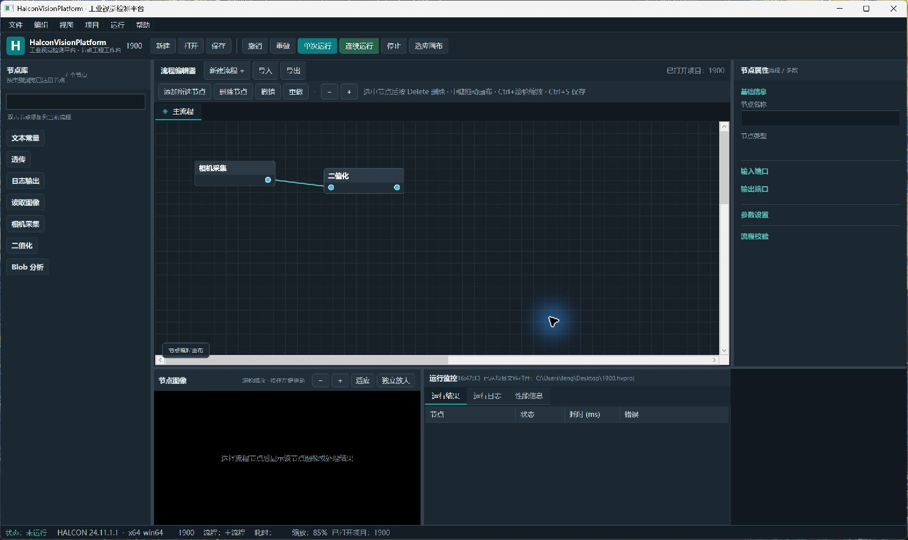

# 项目文件双击打开验收（2026-10-12）

## 复现与原因

从资源管理器双击桌面 `1900.hvproj`，实际启动的是 `artifacts/delete-shortcut/HalconVision.App.exe`。窗口显示“未打开项目”，没有流程节点。该旧版没有当前的启动参数加载行为；项目文件中已有两节点、一条连线。

当时注册表主 ProgId 和 Applications 打开命令已指向 `lifecycle-verified`，但资源管理器仍启动旧路径。仅检查注册表不能证明关联已经生效。

## 修复

- `tools/InstallDesktop.ps1` 将发布输出安装到固定 `artifacts/desktop`，快捷方式和项目打开命令统一指向该目录。
- 备份旧 `delete-shortcut` 输出，并创建指向固定目录的目录联接，兼容仍缓存旧路径的启动入口。备份位于本仓库 artifacts 内。
- 不修改项目文件或 HALCON 安装；不改写 Windows 的受保护默认应用选择。
- 加入启动参数及首次画布节点容器回归检查。现有启动加载代码通过检查，无需改写算法或项目序列化。

## 真实桌面验收

2026-10-12 16:47（Asia/Shanghai），通过资源管理器实际双击 `1900.hvproj`：

- 运行路径：`D:\AiProjects\HalconVisionPlatform\artifacts\desktop\HalconVision.App.exe`。
- 项目名称：1900；流程：主流程。
- 画布直接显示“相机采集 → 二值化”，两节点及一条连线。
- 日志直接显示“已从项目文件打开：C:\Users\feng\Desktop\1900.hvproj”。
- 没有使用程序内“打开”按钮，没有执行相机采集，也没有保存或覆盖用户项目。

## 自动检查

构建：0 错误、0 警告。启动参数四种形式、首次节点容器、其余 UI/生命周期检查均通过，完整输出见 `project-open-20261012.txt`。连续运行两秒获得 58 次 Dispatcher 心跳；停止耗时 15 ms；200 次 HALCON 执行释放 400 个旧图像/区域对象。

第一次全量检查在自动模拟 200 次按钮调用时触发看门狗（heartbeat=0）。检查循环可能在任务已完成时同步继续，未像真实输入一样给后台队列处理机会。为测试循环加入 Background 优先级 Dispatcher 让步后重新全量检查通过；该让步只在检查程序内，产品执行逻辑未改动。
